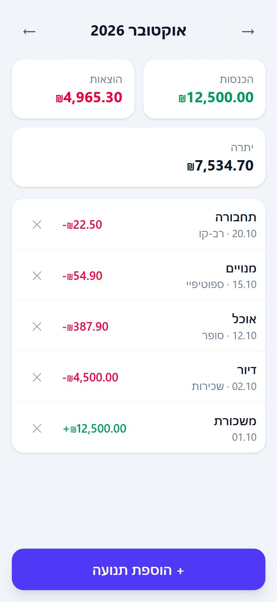
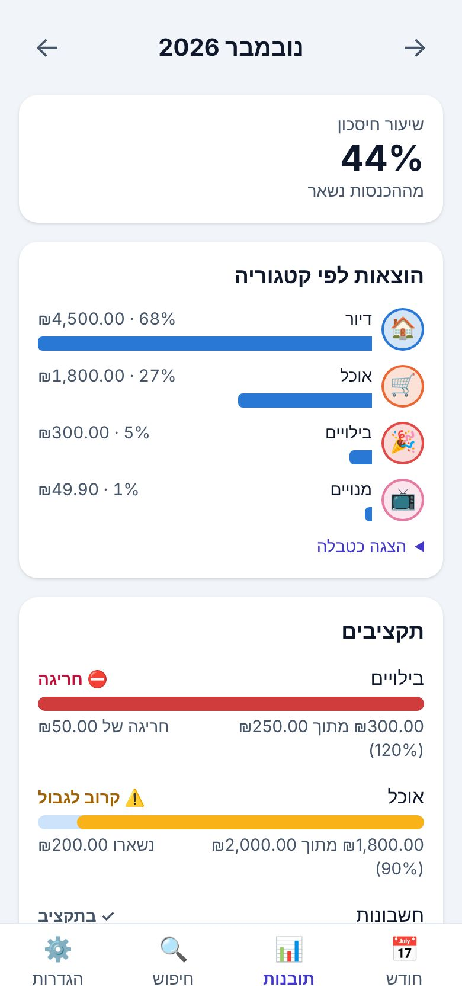

# Money Tracker — מעקב כסף

[](https://github.com/yovelamirtech/money-tracker/actions/workflows/ci.yml)

A mobile-first web app (Hebrew RTL, with an English option) for tracking spending.
Type what went out, and see each month's spending and where the money goes. Income is optional: there's a place to enter it, and it only shows up in a month where you did. Nothing is shown in red.
Everything is stored locally in the browser. No backend, no login. It can be installed on a phone and works offline.

**Live:** https://yovelamirtech.github.io/money-tracker/

 

## Features

- **Entry (home screen):** one line, like `שכ״ד 4000`, and send. The number is the amount and the rest is the note. The latest entries are right below; tap one to fix it, or delete it. A detailed form is there for a date or a monthly repeat.
- **Categories by learning:** an entry gets the category last chosen for the same note; "משכורת" is income. Anything else waits as "no category" until you sort it: one entry at a time, one tap on a category button, and every other entry with the same note goes with it (with undo).
- **Month:** the month's spending (plus income and what's left, only if income was entered); calm amber budget warnings and progress bars; spending by category; changes from last month; a 6/12‑month spending trend; every transaction of the month
- **Recurring transactions:** rent, salary and subscriptions are added automatically every month, never twice
- **Search:** by note, type, category and amount range, across all months
- **Settings:** manage categories (name, emoji, color), recurring items, budgets; light/dark/system theme; Hebrew/English
- **Data:** JSON backup export and import (validated), CSV export for a date range (opens in Excel)

**Install on iPhone:** open the live link in Safari → Share → *Add to Home Screen*.

## Run locally

Requires Node.js 22+.

```bash
npm install
npm run dev
```

## Test, lint, build

```bash
npm test               # unit + component tests (Vitest)
npm run test:coverage  # same, with coverage; fails below 80% on src/lib
npm run test:e2e       # end-to-end tests (Playwright) on the production build
npm run lint           # ESLint
npm run build          # type-check + production build
```

The first time on a new machine, `npx playwright install chromium` downloads the browser for E2E tests.

## How it works

- Money is stored as **integer agorot** (₪12.50 → `1250`), never floats.
- Business logic is in pure functions in `src/lib/` with tests next to each file.
- `src/lib/storage.ts` is the only code that touches `localStorage` (key `money-tracker:v2`).
- UI text lives in `src/i18n/messages.ts` (Hebrew and English).
- Colors are semantic tokens in `src/index.css`, redefined for dark mode.

## CI/CD

`.github/workflows/ci.yml` runs on every push and pull request:

1. **check:** install → lint → tests with coverage → build
2. **e2e:** Playwright tests (main flow, keyboard use, offline/PWA, WCAG AA accessibility scan in light and dark)

A push to `main` that passes both jobs deploys to GitHub Pages automatically.

One-time GitHub setup: **Settings → Pages → Source: GitHub Actions**.

See [money-tracker-plan.md](money-tracker-plan.md) for the full plan and progress.
